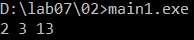
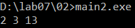
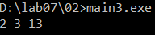
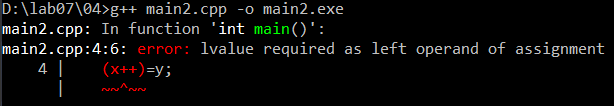
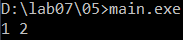
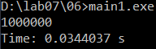
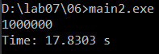

# Языки программирования
## Лабораторная работа 7

### Задание 1 **(2)**
*Оцените работу следующих фрагментов программ. Какие из них обладают неоднозначным поведением? Почему?*

```cpp
#include <iostream>
#include <algorithm>
int main() {
   int x=10, y=3;
   std::cout << std::min(x=15, x+y) << std::endl;
   return 0;
}
```

Этот фрагмент неоднозначный. Порядок вычисления аргументов функции в C++ не определен. Если сначала выполнится x=15, то второй аргумент будет 15+3=18 и min вернет 15. Если сначала посчитается x+y, то второй аргумент будет 10+3=13 и min вернет 13. Например, g++ выдаст 13, а clang++ выдаст 15.

```cpp
#include <iostream>
int main() {
   int x=10, y=3;
   x=15, y+=x, x+=y;
   std::cout << x << " " << y << std::endl;
   return 0;
}
```

Здесь используется оператор запятая, он всегда выполняет действия слева направо. x=15, потом y=3+15=18, потом x=15+18=33. Результат всегда 33 18, поведение однозначное.

```cpp
#include <iostream>
using namespace std;
int main() {
   int x=10, y=9;
   if (x>y++ && y++>9)
      cout << "yes" << endl;
   cout << y << endl;
   return 0;
}
```

Оператор && тоже вычисляет сначала левую часть, потом правую. Сначала сравнивается 10>9 (y++ возвращает старое значение), это истина и y становится 10. Потом 10>9, тоже истина, y становится 11. Выводится yes и 11. Поведение однозначное.

Неоднозначное поведение только у первого фрагмента.

### Задание 2 **(2)**
*Как записать следующие строки программы на С++ в виде одного выражения? Приведите несколько способов, в том числе с использованием операторов инкремента.*
*Проверьте работу написанных программ*
```
x=x+1;
z=z+2*x+3*y;
y=y+1;
```

Начальные значения x=1, y=2, z=3. Должно получиться x=2, y=3, z=3+4+6=13.

Способ 1, через запятую:

```cpp
#include <iostream>
int main() {
   int x=1, y=2, z=3;
   x=x+1, z=z+2*x+3*y, y=y+1;
   std::cout << x << " " << y << " " << z << std::endl;
   return 0;
}
```



Способ 2, через запятую и инкременты:

```cpp
#include <iostream>
int main() {
   int x=1, y=2, z=3;
   ++x, z+=2*x+3*y, ++y;
   std::cout << x << " " << y << " " << z << std::endl;
   return 0;
}
```



Способ 3, инкременты внутри выражения:

```cpp
#include <iostream>
int main() {
   int x=1, y=2, z=3;
   z+=2*++x+3*y++;
   std::cout << x << " " << y << " " << z << std::endl;
   return 0;
}
```



В третьем способе для x используется префиксный инкремент, потому что x нужно увеличить до вычисления z. Для y используется постфиксный, потому что y увеличивается уже после. Все три программы выводят 2 3 13.

### Задание 3 **(2)**
*Рассмотрите следующий фрагмент программы. Он заполняет вектор из 10 элементов единицами.*
```
std::vector<int> x(10);
for (int i = 0; i < 10;)
   x[i++] = 1;
```
*Перепишите ее так, чтобы в третьей строке использовался префиксный инкремент, но результат ее работы не изменился.*

```cpp
#include <iostream>
#include <vector>
int main() {
   std::vector<int> x(10);
   for (int i = -1; i < 9;)
      x[++i]=1;
   for (int i = 0; i < 10; i++)
      std::cout << x[i] << " ";
   std::cout << std::endl;
   return 0;
}
```

++i сначала увеличивает i, поэтому i начинается с -1, чтобы первым заполнился x[0]. Условие поменял на i < 9, чтобы последним заполнился x[9]. Второй цикл нужен только для вывода.

### Задание 4 **(2)**

*Почему присваивание* ```(++x)=y``` *является синтаксически правильным, а*
```(x++)=y``` - *нет? Запишите текст сообщения об ошибке, переведите и объясните его.*

```cpp
#include <iostream>
int main() {
   int x=1, y=5;
   (++x)=y;
   std::cout << x << std::endl;
   return 0;
}
```

```cpp
#include <iostream>
int main() {
   int x=1, y=5;
   (x++)=y;
   std::cout << x << std::endl;
   return 0;
}
```



Текст ошибки: error: lvalue required as left operand of assignment

Перевод: в качестве левого операнда присваивания требуется lvalue.

lvalue - это то, чему можно присвоить значение, например переменная. ++x возвращает саму переменную x, поэтому ей можно присвоить y. x++ возвращает временную копию старого значения x, а не саму переменную, и присвоить ей ничего нельзя.

### Задание 5 **(2)**

*Программисты на Python для обмена значений двух переменных часто пишут строку*
```
a,b = b,a
```
*Проверьте, будет ли аналогичная строка на С++ (с точкой с запятой в конце) являться синтаксически
правильной? Будет ли она обменивать значения переменных? Как в языке С++ вычисляется это выражение?*

```cpp
#include <iostream>
int main() {
   int a=1, b=2;
   a,b = b,a;
   std::cout << a << " " << b << std::endl;
   return 0;
}
```



Строка компилируется, но значения не меняются, выводится 1 2. В C++ запятая здесь это оператор запятая, а приоритет у = выше. Поэтому выражение считается как a, (b=b), a. То есть b присваивается само себе, а a просто вычисляется и ни на что не влияет. Для обмена в C++ можно использовать std::swap(a, b).

### Задание 6 **(2)**

*Проверьте работу следующего фрагмента программы*
```
  std::string s;
  for (int i=0; i<1000000; i++)
     s += 'a';
  std::cout << s.size();
```

```cpp
#include <iostream>
#include <string>
#include <chrono>
int main() {
   auto start = std::chrono::steady_clock::now();

   std::string s;
   for (int i=0; i<1000000; i++)
      s += 'a';
   std::cout << s.size() << std::endl;

   auto end = std::chrono::steady_clock::now();
   std::cout << "Time: "
             << std::chrono::duration<double>(end - start).count()
             << " s" << std::endl;
   return 0;
}
```



*Измените третью строку на*
```
s=s+'a';
```
*Изменится ли что-нибудь в ее работе? Объясните результат.*

```cpp
#include <iostream>
#include <string>
#include <chrono>
int main() {
   auto start = std::chrono::steady_clock::now();

   std::string s;
   for (int i=0; i<1000000; i++)
      s=s+'a';
   std::cout << s.size() << std::endl;

   auto end = std::chrono::steady_clock::now();
   std::cout << "Time: "
             << std::chrono::duration<double>(end - start).count()
             << " s" << std::endl;
   return 0;
}
```



Результат тот же, 1000000, но вторая программа работает намного дольше. s += 'a' просто дописывает символ в конец той же строки. А s=s+'a' каждый раз создает новую строку, копирует в нее всю s, добавляет символ и потом присваивает обратно. Строка становится все длиннее, и копировать приходится все больше, поэтому получается очень медленно.

### Задание 7 **(2)**

*Как работает следующая программа? Как зависит результат от исходного значения?*
```
int x;
std::cin >> x;
x-->0 && x-->0 && x-->0 && x-->0 && x-->0;
std::cout << x;
```

```cpp
#include <iostream>
int main() {
   int x;
   std::cin >> x;
   x-->0 && x-->0 && x-->0 && x-->0 && x-->0;
   std::cout << x << std::endl;
   return 0;
}
```

x-->0 это (x--) > 0, то есть старое значение x сравнивается с нулем, а потом x уменьшается на 1. && выполняет сравнения слева направо и останавливается на первом ложном. Каждое сравнение уменьшает x на 1, даже ложное.

Если x >= 5, то все 5 сравнений истинны и результат x-5. Если x от 1 до 4, то x уменьшается до 0, потом сравнение 0>0 ложно, но x все равно уменьшается, и результат всегда -1. Если x <= 0, то первое же сравнение ложно и результат x-1.

### Задание 8 **(3)**

*Какое число выводит следующий фрагмент программы? Посчитайте результат без использования
вычислительной техники. Отчет должен содержать процесс вычислений.*
```
int s = 0;
for (int i = 0, j = 5;i+j <= 16;(i<j ? i : j)++)
   (s += i) += j;
std::cout << s;
```

(s += i) += j значит s = s + i + j. (i<j ? i : j)++ увеличивает меньшую из переменных, а если они равны, то j. Цикл идет пока i+j <= 16.

i=0, j=5, s=0+5=5

i=1, j=5, s=5+6=11

i=2, j=5, s=11+7=18

i=3, j=5, s=18+8=26

i=4, j=5, s=26+9=35

i=5, j=5, s=35+10=45

i=5, j=6, s=45+11=56

i=6, j=6, s=56+12=68

i=6, j=7, s=68+13=81

i=7, j=7, s=81+14=95

i=7, j=8, s=95+15=110

i=8, j=8, s=110+16=126

i=8, j=9, i+j=17, цикл заканчивается.

Ответ: 126
