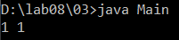
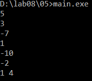
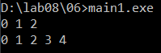
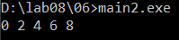
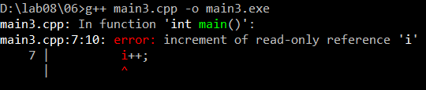
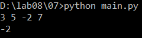
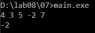
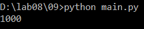

# Языки программирования
## Лабораторная работа 8

### Задание 1 **(2)**
*Рассмотрим программу на языке* **Python**.
```
x = [int(t) for t in input().split()]
for i in range(len(x)):
   if x[i] < i or x[i] > 2*i:
      break
print(i)
```
*Перепишите эту программу так, чтобы в ней использовался цикл* **while**, *в ней не использовалась
инструкция* **break**, *а используемый алгоритм не изменился. Полученная программа должна иметь следующий 
вид.*
```
x = [int(t) for t in input().split()]
i = 0
while ...:
   i += 1
print(i)
```
*Допишите правильное логическое выражение вместо многоточия. Выражение не должно содержать оператор* **not**.

```python
x = [int(t) for t in input().split()]
i = 0
while i < len(x) - 1 and i <= x[i] <= 2*i:
   i += 1
print(i)
```

Цикл for прерывается, когда x[i] < i или x[i] > 2*i. Значит цикл while должен продолжаться при обратном условии, то есть когда i <= x[i] <= 2*i. Еще нужно условие i < len(x) - 1, потому что если break не сработал, то for заканчивается на последнем индексе и выводит len(x) - 1. При вводе 0 1 3 5 20 программа выводит 4, так как 20 > 2*4.

### Задание 2 **(2)**
*Рассмотрим программу на языке* **Python**.
```
x = [int(t) for t in input().split()]
for i in range(len(x)):
   if i <= x[i] < 2*i or 3*i <= x[i] < 4*i:
      break
print(i)
```
*Перепишите эту программу так, чтобы в ней использовался цикл* **while**, *в ней не использовалась
инструкция* **break**, *а используемый алгоритм не изменился. Полученная программа должна иметь следующий 
вид.*
```
x = [int(t) for t in input().split()]
i = 0
while ...:
   i += 1
print(i)
```
*Допишите правильное логическое выражение вместо многоточия. Выражение не должно содержать оператор* **not**.

```python
x = [int(t) for t in input().split()]
i = 0
while i < len(x) - 1 and (x[i] < i or 2*i <= x[i] < 3*i or x[i] >= 4*i):
   i += 1
print(i)
```

Цикл прерывается, когда x[i] попадает в промежуток [i; 2i) или [3i; 4i). Цикл while должен продолжаться, когда x[i] не попадает в эти промежутки, то есть x[i] < i, или x[i] в промежутке [2i; 3i), или x[i] >= 4i. Условие i < len(x) - 1 нужно так же, как в первом задании. При вводе 0 5 7 3 20 программа выводит 2, так как 7 попадает в [6; 8).

### Задание 3 **(2)**

*Напишите пример программы на* **Java** *с двумя вложенными циклами и инструкцией* **break** *для выхода
из двух вложенных циклов. В качестве такой программы можно взять поиск первого нуля в двумерном массиве.*

```java
public class Main {
    public static void main(String[] args) {
        int[][] a = {
            {1, 2, 3},
            {4, 0, 6},
            {7, 8, 0}
        };
        int row = -1, col = -1;
        outer:
        for (int i = 0; i < a.length; i++) {
            for (int j = 0; j < a[i].length; j++) {
                if (a[i][j] == 0) {
                    row = i;
                    col = j;
                    break outer;
                }
            }
        }
        System.out.println(row + " " + col);
    }
}
```



В Java перед циклом можно поставить метку (здесь outer). Команда break outer выходит сразу из цикла с этой меткой, то есть из обоих циклов. Программа находит первый ноль в строке 1, столбце 1 и выводит 1 1. Второй ноль в a[2][2] уже не проверяется.

### Задание 4 **(2)**

*Рассмотрим программу на языке* **Python**.
```
a = list(range(10))
b = [a.pop() - x for x in a]
print(*b)
```
*Объясните, почему список* **b** *получился именно таким.*

```python
a = list(range(10))
b = [a.pop() - x for x in a]
print(*b)
```

Программа выводит 9 7 5 3 1. Цикл идет по списку a и одновременно удаляет из него последний элемент через a.pop(). Поэтому список становится короче прямо во время цикла.

1 шаг: x = 0, pop удаляет 9, 9 - 0 = 9

2 шаг: x = 1, pop удаляет 8, 8 - 1 = 7

3 шаг: x = 2, pop удаляет 7, 7 - 2 = 5

4 шаг: x = 3, pop удаляет 6, 6 - 3 = 3

5 шаг: x = 4, pop удаляет 5, 5 - 4 = 1

После 5 шагов в a осталось 5 элементов [0, 1, 2, 3, 4], и они все уже пройдены, поэтому цикл заканчивается. Получается 5 элементов, а не 10.

### Задание 5 **(2)**

*Напишите программу на С++, которая прочитает натуральное число* **n**, *создаст вектор
из* **n** *элементов, прочитает значения элементов, добавит последний элемент вектора к каждому элементу 
(в том числе и к последнему), найдет и выведет количество положительных и отрицательных элементов вектора
после изменения. Из циклов в программе можно использовать только циклы по коллекции.*

```cpp
#include <iostream>
#include <vector>
int main() {
   int n;
   std::cin >> n;
   std::vector<int> v(n);
   for (int &x : v)
      std::cin >> x;
   int last = v[n-1];
   for (int &x : v)
      x += last;
   int pos = 0, neg = 0;
   for (int x : v) {
      if (x > 0) pos++;
      if (x < 0) neg++;
   }
   std::cout << pos << " " << neg << std::endl;
   return 0;
}
```



Последний элемент сохраняется в отдельную переменную last до изменения вектора. Если прибавлять v[n-1] напрямую, то после изменения последнего элемента прибавлялось бы уже другое значение. В циклах используется int &x, чтобы менять сами элементы вектора, а не их копии. При вводе 5 и 3 -7 1 -10 -2 вектор становится 1 -9 -1 -12 -4, выводится 1 4.

### Задание 6 **(3)**

*Представим, что в некотором будущем стандарте* **С++** *появится конструкция*
```
forc(i, from, to)
```
*которая будет раскрываться в следующий код.*
```
{
   int __i = from, __n=to;
   for(const int &i= __i; i < __n; __i++) {
      ...
   }
}
```
*Чем эта конструкция отличается от стандартного цикла* **for**? *Укажите два основных различия.
Напишите программы для демонстрации этих различий.*

*Написанные программы сохраните в папку с номером задания.*

Первое различие: граница to вычисляется один раз до начала цикла и сохраняется в __n. Если в теле цикла изменить переменную, которая была границей, количество повторений не изменится. В обычном for условие i < n проверяется каждый раз с текущим значением n.

```cpp
#include <iostream>
int main() {
   int n = 5;
   for (int i = 0; i < n; i++) {
      std::cout << i << " ";
      n--;
   }
   std::cout << std::endl;

   n = 5;
   {
      int __i = 0, __n = n;
      for (const int &i = __i; i < __n; __i++) {
         std::cout << i << " ";
         n--;
      }
   }
   std::cout << std::endl;
   return 0;
}
```



Обычный for выводит 0 1 2, потому что n уменьшается и цикл заканчивается раньше. forc выводит 0 1 2 3 4, изменение n на цикл не влияет.

Второе различие: i объявлена как константная ссылка, поэтому внутри цикла ее нельзя изменить. В обычном for переменную цикла менять можно.

```cpp
#include <iostream>
int main() {
   for (int i = 0; i < 10; i++) {
      std::cout << i << " ";
      i++;
   }
   std::cout << std::endl;
   return 0;
}
```



Обычный for выводит 0 2 4 6 8, так как i увеличивается еще и в теле цикла.

```cpp
#include <iostream>
int main() {
   {
      int __i = 0, __n = 10;
      for (const int &i = __i; i < __n; __i++) {
         std::cout << i << " ";
         i++;
      }
   }
   std::cout << std::endl;
   return 0;
}
```



С forc программа не компилируется: error: increment of read-only reference 'i' (увеличение ссылки 'i', доступной только для чтения).

### Задание 7 **(2)**

*Напишите программу на языке* **Python** *для проверки того, что все числа во введенной 
последовательности неотрицательные. Если в цикле будет найдено отрицательное число, цикл должен
прерваться и вывести найденное число. Если отрицательных чисел нет, то вывести некоторое сообщение об этом.*

*Программа должна использовать конструкцию* **for break else**.

```python
a = [int(t) for t in input().split()]
for x in a:
   if x < 0:
      print(x)
      break
else:
   print("all numbers are non-negative")
```



Блок else выполняется только если цикл закончился сам, без break. То есть если отрицательное число не найдено.

*Запишите аналогичную программу на С++. Какие изменения в алгоритме решения в ней появились?. Почему?*

```cpp
#include <iostream>
#include <vector>
int main() {
   int n;
   std::cin >> n;
   std::vector<int> a(n);
   for (int &x : a)
      std::cin >> x;
   bool found = false;
   for (int x : a) {
      if (x < 0) {
         std::cout << x << std::endl;
         found = true;
         break;
      }
   }
   if (!found)
      std::cout << "all numbers are non-negative" << std::endl;
   return 0;
}
```



В C++ нет конструкции for else, поэтому пришлось добавить переменную found. Она становится true, если найдено отрицательное число, а после цикла по ней проверяется, был ли break. Еще в C++ сначала вводится количество чисел n, так как прочитать всю строку сразу в вектор, как в Python, сложнее.

### Задание 8 **(2)**

*Рассмотрим следующую программу.* 
```
if x>=5 and y>=-5:
   print(0):
elif x<0 or y<0:
   print(1):
else:
   print(2):
```
*Опишите множества значений при которых программа выводит 0, 1 и 2. Например,*

A={ (x,y)| x ∈ [5;∞), y ∈ [-5;∞)}

0 выводится, когда выполнено первое условие:

A={ (x,y)| x ∈ [5;∞), y ∈ [-5;∞)}

1 выводится, когда первое условие не выполнено, а x<0 или y<0. Если x<0, то первое условие точно не выполнено, y любое. Если x>=0 и y<0, то нужно, чтобы не выполнялось первое условие, то есть x<5 или y<-5:

B={ (x,y)| x ∈ (-∞;0), y ∈ (-∞;∞)} ∪ { (x,y)| x ∈ [0;5), y ∈ (-∞;0)} ∪ { (x,y)| x ∈ [5;∞), y ∈ (-∞;-5)}

2 выводится во всех остальных случаях. Тогда x>=0 и y>=0, но первое условие не выполнено, значит x<5:

C={ (x,y)| x ∈ [0;5), y ∈ [0;∞)}

###  Задание 9 **(3)**
*Напишите программу на языке Python для решения следующей задачи.*

*Задана пронумерованная последовательность логических значений* **t(0),t(1),..,t(n)**, **t(i) ∈ {False,True}**

*Последовательность обладает следующим свойством: существует некоторое число k такое, что 
все значения* **t(0),t(1),...,t(k-1)** *равны* **False**, *а все значения* **t(k), ... , t(n)** *равны* **True**,
*то есть слева от* **k** *находятся значения* **False**, *а справа* - **True**. *Последовательность задается
функцией* **t(i)**, *которая возвращает логическое значение.*

*Требуется написать программу, которая найдет число* **k**. *Программа должна реализовывать алгоритм 
бинарного поиска.*

```python
def t(i):
   return i >= 1000

left = -1
right = 10**18
while right - left > 1:
   mid = (left + right) // 2
   if t(mid):
      right = mid
   else:
      left = mid
print(right)
```



Считаем, что t(-1) = False и t(10**18) = True, тогда инвариант выполняется в начале. На каждом шаге берется середина mid. Если t(mid) = True, то k находится слева или в mid, и right = mid. Если False, то k справа, и left = mid. Так инвариант t(left)=False и t(right)=True сохраняется. Цикл заканчивается, когда left и right стоят рядом. Тогда right это первое значение True, то есть k. Программа выводит 1000.
