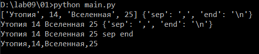
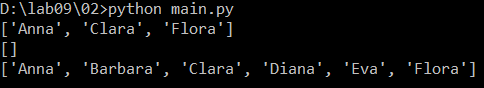
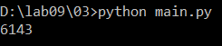
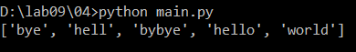
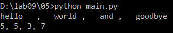
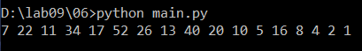
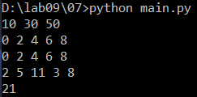
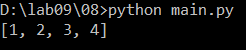
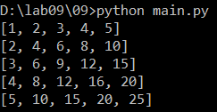
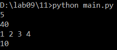

# Языки программирования
## Лабораторная работа 9

### Задание 1 **(2)**
*Рассмотрим следующую программу.*
```
d = {'sep': ',' , 'end': '\n'}
l = ['Утопия', 14, 'Вселенная', 25]
print (l, d)
print (*l, d)
print (*l, *d)
print (*l, **d)
```
*Объясните результаты ее работы.*

Программа выводит:
```
['Утопия', 14, 'Вселенная', 25] {'sep': ',', 'end': '\n'}
Утопия 14 Вселенная 25 {'sep': ',', 'end': '\n'}
Утопия 14 Вселенная 25 sep end
Утопия,14,Вселенная,25
```



В первой строке print получает два аргумента, список и словарь, и выводит их целиком.

Во второй строке *l распаковывает список, и print получает 4 элемента списка отдельными аргументами и еще словарь. Элементы выводятся через пробел, словарь целиком.

В третьей строке *d распаковывает словарь. При распаковке словаря через одну звездочку получаются только его ключи, поэтому выводятся sep и end.

В четвертой строке **d распаковывает словарь как именованные аргументы, то есть получается print('Утопия', 14, 'Вселенная', 25, sep=',', end='\n'). Поэтому элементы выводятся через запятую.

### Задание 2 **(2)**
*Напишите функцию* **sublist** *для решения следующей задачи.*

*На вход функции поступает список или кортеж и набор номеров позиций.
Функция должна составить и вернуть список из элементов, которые
находятся на этих позициях.*

```python
def sublist(lst, *pos):
    return [lst[i] for i in pos]

lst = ['Anna', 'Barbara', 'Clara', 'Diana', 'Eva', 'Flora']
print(sublist(lst, 0, 2, 5))
print(sublist(lst))
print(sublist(lst, 0, 1, 2, 3, 4, 5))
```



*pos собирает все номера позиций после первого аргумента в кортеж. Если номеров нет, кортеж пустой и функция возвращает пустой список.

### Задание 3 **(1)**

*Задан список* **lst** *из натуральных чисел*. *Напишите фрагмент
программы, состоящий из одного вызова функции* **max**, *который найдет в этом списке число с максимальным
числом единиц в двоичной записи.*

```python
lst = list(range(6000, 7000))
ans = max(lst, key=lambda x: bin(x).count('1'))
print(ans)
```



Параметр key задает, по какому значению сравнивать элементы. Лямбда-функция переводит число в двоичную запись через bin и считает в ней единицы через count.

### Задание 4 **(2)**

*Запишите фрагмент программы, которая упорядочит список слов
по длине, а при равенстве длины - лексикографически. Сортировка
должна состоять из одного вызова метода* **sort**.

```python
lst = ['hello', 'hell', 'bye', 'world', 'bybye']
lst.sort(key=lambda s: (len(s), s))
print(lst)
```



Ключ сортировки это кортеж (длина, слово). Кортежи сравниваются сначала по первому элементу, а если он равен, то по второму. Поэтому слова сортируются по длине, а слова одной длины по алфавиту.

### Задание 5 **(2)**

*Напишите программу для решения следующей задачи.*

*В одной строке через запятую записана последовательность слов. Перед
запятой или после нее могут быть пробелы, сами слова пробелов не
содержат. Программа должна вывести в одной строке через запятую
последовательность чисел, равных длине каждого слова.*

```python
print(*map(len, map(str.strip, input().split(','))), sep=', ')
```



split(',') делит строку по запятым, map(str.strip, ...) убирает пробелы у каждого слова, map(len, ...) находит длины. Звездочка передает длины в print отдельными аргументами, а sep=', ' выводит их через запятую.

### Задание 6 **(2)**

*Запишите генератор в форме функции, который будет создавать
последовательность по следующему правилу.*

* *Если текущее число x в последовательности четное, то следующее число равно x/2.*
* *Иначе следующее число равно 3x + 1.*

*Последовательность начинается с заданного числа n и заканчивается единицей.*

```python
def gen(n):
    while n != 1:
        yield n
        if n % 2 == 0:
            n = n // 2
        else:
            n = 3 * n + 1
    yield 1

print(*gen(7))
```



yield возвращает очередное число и приостанавливает функцию до запроса следующего числа. Когда n становится 1, цикл заканчивается и в конце выдается 1. Используется деление // чтобы числа оставались целыми.

### Задание 7 **(2)**

*Напишите генератор, который для заданной последовательности*
**seq** *будет задавать последовательность из каждого второго элемента* **seq**.

```python
def every_other(seq):
    for i, x in enumerate(seq):
        if i % 2 == 0:
            yield x

print(*every_other([10, 20, 30, 40, 50]))
print(*every_other(range(10)))
print(*every_other(iter(range(10))))
print(sum(every_other(map(int, input().split()))))
```



enumerate дает номер каждого элемента, и генератор выдает элементы с четными номерами. Срез seq[::2] тут не подходит, потому что у итератора и map нельзя брать срез, а через for можно пройти по любой последовательности.

### Задание 8 **(2)**

*Задан список* **lst**, *в котором записаны вперемешку числа и строки.
Напишите фрагмент программы, состоящий из одного конструктора списков, который построит новый список, состоящий только из чисел.*

```python
lst = [1, 'abc', 2, 3, 4, 'aa']
nums = [x for x in lst if type(x) == int]
print(nums)
```



В список попадают только те элементы, у которых тип int.

###  Задание 9 **(2)**

*Напишите фрагмент программы, состоящий из одного конструктора списков, который построит двумерный список в виде таблицы умножения размера*
**n×n**.

```python
n = 5
tblmul = [[i * j for j in range(1, n + 1)] for i in range(1, n + 1)]
print(*tblmul, sep='\n')
```



Внешний конструктор создает строки для i от 1 до n, внутренний заполняет строку произведениями i * j.

###  Задание 10 **(1)**
*Какие из указанных функций и методов Python соответствуют определению чистых функций?
В случае отрицательного ответа требуется дать пояснение.*

Чистая функция всегда возвращает одинаковый результат для одинаковых аргументов и ничего не меняет вне себя.

file.readline - не чистая. Каждый вызов возвращает следующую строку файла, то есть результат разный, и при этом меняется позиция чтения в файле.

len - чистая.

list.append - не чистая. Она изменяет сам список, который ей передали.

sum - чистая.

sorted - чистая. Она создает новый список и не меняет исходный.

list.sort - не чистая. Она изменяет исходный список.

random.randint - не чистая. При одних и тех же аргументах возвращает разные числа.

rev - чистая. Срез x[::-1] создает новый список и не меняет x.

tail - не чистая. Результат зависит от глобальной переменной tail_len, если ее изменить, то при том же аргументе результат будет другим.

###  Задание 11 **(2)**
*Рассмотрите следующую функцию.*
```
def toint(fun):
    def wrapper(*args):
        return fun(*map(int, args))
    return wrapper
```
*Что передается в функцию* **toint**? *Что возвращает эта функция?*
*Что делает функция* **wrapper**?
*Придумайте несколько примеров использования* **toint**.

В toint передается функция fun. toint возвращает новую функцию wrapper. wrapper принимает любое количество аргументов, переводит их все в int и вызывает с ними fun. То есть toint делает из функции новую функцию, которой можно передавать числа строками.

```python
def toint(fun):
    def wrapper(*args):
        return fun(*map(int, args))
    return wrapper

add = toint(lambda a, b: a + b)
print(add('2', '3'))

imax = toint(max)
print(imax('5', '40', '7'))

isum = toint(lambda *a: sum(a))
print(isum(*input().split()))
```



add('2', '3') выводит 5, а не '23', так как строки переводятся в числа. imax выводит 40, если бы сравнивались строки, то ответ был бы '7'. isum считает сумму чисел, введенных в одной строке.
