# Языки программирования
## Лабораторная работа 10

### Задание 1 **(2)**

*Рассмотрите следующие фрагменты программ. Запишите, что означают символы* **&** *и* **\*** *в каждом случае применения.*

```
int a = 10, b = 20;
int *p = &a , *q = &b;
p = q;
std::cout << *p << ' ' << *q << std::endl;
```

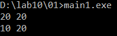

```
int a = 10, b = 20;
int *p = &a , *q = &b;
*p = *q;
std::cout << *p << ' ' << *q << std::endl;
```

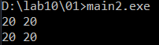

Значение символов в этих программах:

* `*` в объявлении `int *p` и `int *q` - описатель указателя. Он означает, что переменная хранит не число, а адрес другой переменной типа int.
* `&` в `&a` и `&b` - оператор взятия адреса. Он возвращает адрес переменной.
* `*` в `*p` и `*q` в выражениях - оператор разыменования. Он дает значение, которое лежит по адресу, хранящемуся в указателе.

*Чем различаются присваивания в третьей строке? Что можно вывести, чтобы показать различия?*

В первой программе `p = q;` присваивает один указатель другому. Теперь p хранит адрес переменной b, то есть p и q указывают на одну переменную b. Переменная a не изменилась.

Во второй программе `*p = *q;` присваивает значения. В переменную, на которую указывает p (это a), записывается значение переменной b. Указатели остались прежними, p указывает на a, q на b.

Чтобы показать различие, я добавил вывод самих переменных a и b. В первой программе они равны 10 и 20 (изменились только указатели), во второй 20 и 20 (изменилось значение a).

### Задание 2 **(1)**

*Рассмотрим следующую программу.*

```
double x[10];
for (int i = 0; i < 10; i++)
   std::cout << &x[i] << std::endl;
```

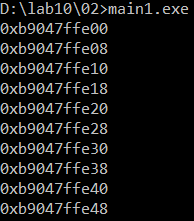

Программа выводит адреса элементов массива x в шестнадцатеричной системе счисления.

*Измените вывод так, чтобы адреса выводились в десятичной системе счисления.*

```
double x[10];
for (int i = 0; i < 10; i++)
   std::cout << reinterpret_cast<size_t>(&x[i]) << std::endl;
```

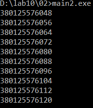

`reinterpret_cast<size_t>` превращает адрес в обычное целое число, и оно выводится в десятичной системе.

*Объясните почему числа составляют арифметическую прогрессию с определенным шагом.*

Элементы массива лежат в памяти один за другим без промежутков. Каждый элемент типа double занимает 8 байт, поэтому адрес каждого следующего элемента больше предыдущего на 8. Получается арифметическая прогрессия с шагом 8.

### Задание 3 **(2)**

*Токен* `*` *в языке C++ может использоваться в трех различных случаях. Аналогично токен* `&` *также может использоваться в трех случаях. Приведите пример одной программы в которой они были бы использованы во всех случаях.*

```
int a = 6, b = 3;
int *p = &a;
int &r = b;
int m = *p * r;
int t = a & b;
std::cout << m << ' ' << t << std::endl;
```

Символ `*`:

* в `int *p` - описатель указателя;
* в первом `*` выражения `*p * r` - разыменование указателя, получаем значение a;
* во втором `*` выражения `*p * r` - умножение.

Символ `&`:

* в `&a` - взятие адреса;
* в `int &r` - описатель ссылки, r становится другим именем переменной b;
* в `a & b` - побитовое И.

Программа выводит `18 2`. Значение m равно 6 * 3 = 18. Для t числа в двоичной записи 110 и 011, побитовое И дает 010, то есть 2.

### Задание 4 **(2)**

*Выпишите значения всех переменных, в том числе указателей, после выполнения каждой инструкции программы. Объясните, что происходит в результате выполнения каждой инструкции.*

```
unsigned a = 8, b = 3 ,c = 17;
unsigned *p = &a;
unsigned *q = &b;
*p += *q + c;
c = *q;
p = &c;
c += a;
*p += 10;
*q = *p;
q = p ;
*q += 10;
```

`unsigned a = 8, b = 3, c = 17;` - создаются три переменные: a = 8, b = 3, c = 17.

`unsigned *p = &a;` - создается указатель p, в него записывается адрес a. Значения: a = 8, b = 3, c = 17, p указывает на a.

`unsigned *q = &b;` - указатель q хранит адрес b. Значения: a = 8, b = 3, c = 17, p указывает на a, q указывает на b.

`*p += *q + c;` - p указывает на a, q на b. К a прибавляется b + c, то есть a = 8 + 3 + 17 = 28. Значения: a = 28, b = 3, c = 17, p указывает на a, q указывает на b.

`c = *q;` - в c записывается значение, на которое указывает q, то есть значение b. c = 3. Значения: a = 28, b = 3, c = 3, p указывает на a, q указывает на b.

`p = &c;` - в p записывается адрес c, теперь p указывает на c. Значения: a = 28, b = 3, c = 3, p указывает на c, q указывает на b.

`c += a;` - c = 3 + 28 = 31. Значения: a = 28, b = 3, c = 31, p указывает на c, q указывает на b.

`*p += 10;` - p указывает на c, поэтому c = 31 + 10 = 41. Значения: a = 28, b = 3, c = 41, p указывает на c, q указывает на b.

`*q = *p;` - значение, на которое указывает q (это b), становится равно значению, на которое указывает p (это c). b = 41. Значения: a = 28, b = 41, c = 41, p указывает на c, q указывает на b.

`q = p;` - в q записывается адрес из p, теперь q тоже указывает на c. Значения: a = 28, b = 41, c = 41, p указывает на c, q указывает на c.

`*q += 10;` - q указывает на c, поэтому c = 41 + 10 = 51. Значения: a = 28, b = 41, c = 51, p указывает на c, q указывает на c.

Итог: a = 28, b = 41, c = 51, оба указателя указывают на c.

### Задание 5 **(1)**

*Что сравнивается в приведенной ниже программе? Как можно изменить первую строчку программы, чтобы результат тоже изменился?*

```
int x = 1, y = 2;
int *p = &y, *q = &x;
if (p < q)
   std::cout << "Yes";
else
   std::cout << "No";
```

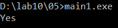

В программе сравниваются не значения x и y, а адреса этих переменных в памяти: p хранит адрес y, q хранит адрес x. Результат зависит от того, в каком порядке переменные расположены в памяти.

Если поменять местами объявление x и y в первой строке, то порядок переменных в памяти изменится и результат тоже изменится.

```
int y = 2, x = 1;
int *p = &y, *q = &x;
if (p < q)
   std::cout << "Yes";
else
   std::cout << "No";
```

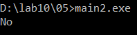

### Задание 6 **(2)**

*Объясните работу следующей программы. Как изменится результат, если тип* **double** *изменить на некоторый другой, например* **int** *или* **char**?

```
double x = 0;
double *d = &x;
std::cout << reinterpret_cast<size_t>(d + 4) - reinterpret_cast<size_t>(d - 4) << std::endl;
```

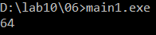

Когда к указателю прибавляют число, адрес сдвигается на столько элементов, а не байт. Значит `d + 4` это адрес на 4 элемента типа double вперед, то есть на 4 * 8 = 32 байта. `d - 4` - адрес на 32 байта назад. `reinterpret_cast<size_t>` превращает адреса в обычные числа, и они вычитаются. Разница 32 + 32 = 64 байта. Память по адресу `d - 4` не читается, используется только сам адрес.

Если изменить тип, изменится размер элемента, а значит и результат. Для int (4 байта) получится 4 * 4 * 2 = 32, для char (1 байт) получится 4 * 1 * 2 = 8.

```
double x = 0;
double *d = &x;
std::cout << reinterpret_cast<size_t>(d + 4) - reinterpret_cast<size_t>(d - 4) << std::endl;

int y = 0;
int *i = &y;
std::cout << reinterpret_cast<size_t>(i + 4) - reinterpret_cast<size_t>(i - 4) << std::endl;

char z = 0;
char *c = &z;
std::cout << reinterpret_cast<size_t>(c + 4) - reinterpret_cast<size_t>(c - 4) << std::endl;
```

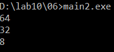

### Задание 7 **(2)**

*Объясните работу следующей программы. Как изменится результат, если тип* **double** *изменить на некоторый другой, например* **int** *или* **char**?

```
std::cout << reinterpret_cast <double*>(3000) - reinterpret_cast <double*>(2000) << std::endl;
std::cout << reinterpret_cast <int*>(3000) - reinterpret_cast <int*>(2000) << std::endl;
std::cout << reinterpret_cast <char*>(3000) - reinterpret_cast <char*>(2000) << std::endl;
```

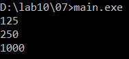

`reinterpret_cast <double*>(3000)` превращает число 3000 в указатель, то есть число считается адресом. Разность двух указателей показывает, сколько элементов данного типа помещается между этими адресами. Между адресами 2000 и 3000 лежит 1000 байт, а один double занимает 8 байт, поэтому 1000 / 8 = 125 элементов.

Если изменить тип, результат изменится: для int (4 байта) получится 1000 / 4 = 250, для char (1 байт) получится 1000 / 1 = 1000. В программе первая строка вывода это исходная программа, вторая и третья - с типами int и char.

### Задание 8 **(2)**

*Что надо дописать в записанной ниже программе вместо многоточий, чтобы она выводила все числа из массива* **a**? *Почему?*

```
int a[20];
for ( int i = 0; i < 20; i++)
   a[i] = i;
int *b = a + 8;
for (int i = -8; i < 12; i++)
   std::cout << b[i] << ' ';
std::cout << std::endl;
```

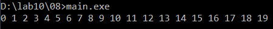

Указатель b указывает на элемент a[8]. Запись `b[i]` означает элемент, который находится на i позиций от b, то есть `a[8 + i]`. Чтобы вывести весь массив от a[0] до a[19], нужно чтобы 8 + i менялось от 0 до 19. Значит, i должно идти от -8 до 11, то есть `i = -8` и `i < 12`. Отрицательный индекс у указателя допустим, если итоговый адрес остается внутри массива.

### Задание 9 **(2)**

*Что выводит следующая программа? Изменится ли результат если изменить тип элементов массива?*

```
int a[10];
std::cout << &a[8] - &a[3] << std::endl;

double b[10];
std::cout << &b[8] - &b[3] << std::endl;
```

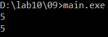

Программа выводит 5. Это разность двух указателей, она показывает, сколько элементов лежит между ними (8 - 3 = 5).

Если изменить тип элементов, результат не изменится. Разность адресов в байтах делится на размер элемента, поэтому получается количество элементов. Во второй части программы стоит тип double, и результат тоже 5.

### Задание 10 **(1)**

*Есть ли разница между инициализацией* **p** *и* **q** *в следующей программе? Обоснуйте ответ.*

```
int x [10]={1, 2, 3, 4, 5, 6, 7, 8, 9, 10};
int *p = x + 5;
int *q = &x[5];
std::cout << p << ' ' << q << std::endl;
std::cout << *p << ' ' << *q << std::endl;
```

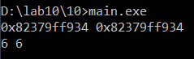

Разницы нет. Имя массива x в выражении означает указатель на его первый элемент, поэтому `x + 5` это указатель на элемент с индексом 5. Запись `&x[5]` это адрес элемента x[5], а x[5] то же самое, что `*(x + 5)`, значит `&x[5]` равно `x + 5`.

Чтобы это показать, программа выводит p и q (адреса одинаковые), а потом `*p` и `*q` (значения одинаковые, 6).

### Задание 11 **(3)**

*Указатели можно использовать для итерации по массивам. Напишите программу, которая найдет сумму элементов массива, используя указатели. В начале цикла указатель требуется установить на начало массива, в конце каждой итерации смещать его к следующему элементу массива через инкремент. Для выхода из цикла надо проверять, что указатель дошел до конца массива.*

```
int x [10]={1, 2, 3, 4, 5, 6, 7, 8, 9, 10};
int s = 0;
for (int *p = x; p != x + 10; p++)
   s += *p;
std::cout << s << std::endl;
```

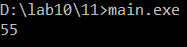

`int *p = x` - в начале цикла указатель p устанавливается на начало массива. `p != x + 10` - условие продолжения цикла: `x + 10` это адрес сразу за последним элементом, и когда p до него дошел, массив закончился. `p++` - сдвигает указатель на следующий элемент. `s += *p` - к сумме прибавляется значение элемента, на который сейчас указывает p. Программа выводит 55.
